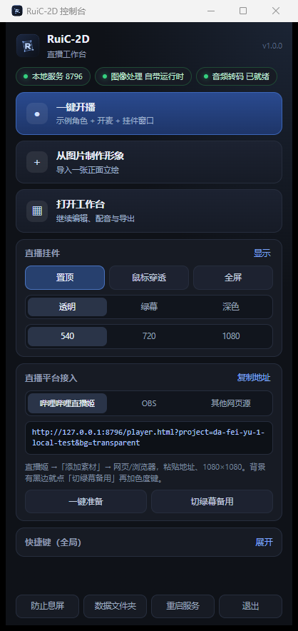

# RuiC-2D 桌面版（Windows）

原版要在命令行里 `npm start`、装 Python 依赖、再手动把地址贴进 OBS。桌面版把这些收进一个 exe：双击就开，自带 Node 与 Python 图像运行时，并补上直播真正需要的东西——透明挂件窗口、全局快捷键、托盘控制台。




## 安装包

| 文件 | 说明 |
| --- | --- |
| `RuiC-2D-Setup-1.0.0.exe` | 安装版。装到当前用户，创建桌面与开始菜单快捷方式，可自选目录 |
| `RuiC-2D-1.0.0-x64.zip` | 免安装版。解压后双击其中的 `RuiC-2D.exe` |

系统要求：Windows 10 1903 或更高、64 位。不用另外装 Node.js 和 Python；只有「导入配音」需要 FFmpeg（可选，麦克风直播不需要）。

## 第一次启动

1. 双击桌面的「RuiC-2D 直播工作台」，出现**控制台**小窗。
2. 首次启动会把三个示例角色复制到数据目录（约 90 MB，只做一次），状态灯从「服务启动中」变为「本地服务 8796」后即可使用。
3. 点「一键开播」：打开工作台并切到「直播」页、打开麦克风、弹出角色挂件窗口。

数据都在 `%APPDATA%\RuiC-2D\data`（工程、导出、日志），卸载不会删除。

## 控制台

- **一键开播** — 示例角色 + 开麦 + 挂件，一条龙。
- **从图片制作形象** — 直接打开导入图片的对话框。
- **打开工作台** — 进入编辑器（角色库、配音、绑定、导出都在里面）。
- **直播挂件** — 显示/隐藏、置顶、鼠标穿透、全屏、背景（透明/绿幕/深色）、尺寸（540/720/1080）。
- **OBS 地址** — 复制浏览器源地址。
- **底部** — 防止息屏、数据文件夹、重启服务、退出。

关掉控制台窗口不会退出程序，它留在系统托盘里（双击托盘图标可再打开）。

## 接 OBS

### 方式 A：窗口采集（推荐，能实时对口型）

1. OBS 里 `来源 → + → 窗口采集`。
2. 窗口选 **RuiC-2D 挂件**。
3. 采集方法选 **Windows 10 (1903 及以上) 图形捕获**，并勾选 **允许透明**。
4. 把来源缩放到 1080 × 1080（或你需要的画布比例），角色自带透明背景。

这样麦克风、摄像头驱动的表情会实时出现在直播画面里。工作台窗口可以最小化，但不要关闭。

### 方式 B：浏览器源（也能实时，已支持）

复制控制台里的地址，在 OBS 添加**浏览器**来源（建议 1080 × 1080）。

桌面版内置了本机 WebSocket 中继（`ws://127.0.0.1:8796/ws/live?project=<工程>`）：工作台把驱动帧推给同一工程的所有连接，所以 OBS 浏览器源、直播姬网页素材、手机预览都能实时对口型，不只是待机动画。前提是**保持工作台窗口开着**（最小化也可以）。

### 没有「允许透明」时用绿幕

控制台把挂件背景切成**绿幕**，OBS 里给窗口采集加「色度键」滤镜、颜色选绿色即可。

## 接哔哩哔哩直播姬

### 方式 A：网页素材（推荐，实时对口型）

1. 控制台「直播平台接入」里选 **哔哩哔哩直播姬**，点 **一键准备**：挂件切到 1080、自动打开、地址已复制。
2. 直播姬 → 左下 **添加素材 → 网页 / 浏览器**（不同版本叫法略有差异）。
3. 粘贴地址，宽高填 **1080 × 1080**。
4. 保持工作台窗口开着。对着麦克风说话，网页里的角色就会跟着动。

如果网页素材里出现**黑底或白底**（说明该版本的网页素材不保留透明），点控制台的 **切绿幕备用**，再给这个素材加 **色度键 / 抠像**，颜色选绿色。

### 方式 B：窗口采集

不想用网页素材时：**添加素材 → 窗口 → RuiC-2D 挂件**。能透明就透明，不能就配绿幕 + 色度键。

窗口采集更省 CPU，但抓的是画面本身：游戏/播放器用独占全屏时可能抓不到，改窗口模式或无边框窗口更稳。

### 直播姬里的几个细节

- 网页素材和 OBS 浏览器源是**同一个地址**，改工程后地址里的 `project=` 会变，重新复制一次即可。
- 网页素材是独立渲染：工作台里切换形象，挂件窗口会立刻跟着换，网页素材则要重新复制新地址（或用 OBS 那条窗口采集，自动跟随）。
- 想把角色叠在摄像头画面角落：网页素材放底层，摄像头素材调小放右上角；或者干脆用挂件窗口 + 窗口采集。
- 直播姬关机重启后素材会保留，但本地服务端口若被占用会自动换端口，记得回控制台重新复制地址。

## 快捷键（全局，游戏/其他窗口在前台也生效）

| 快捷键 | 作用 |
| --- | --- |
| `Ctrl+Alt+H` | 打开 / 收起控制台 |
| `Ctrl+Alt+P` | 显示 / 隐藏直播挂件 |
| `Ctrl+Alt+W` | 打开工作台 |
| `Ctrl+Alt+T` | 挂件置顶开关 |
| `Ctrl+Alt+G` | 挂件鼠标穿透开关（穿透后拖动需先关掉） |
| `Ctrl+Alt+F` | 挂件全屏 |
| `Ctrl+Alt+B` | 切换挂件背景（透明 → 绿幕 → 深色） |
| `Ctrl+Alt+1/2/3` | 挂件切到 540 / 720 / 1080 |

## 直播时的小技巧

- 挂件窗口在屏幕上可以直接拖动到任意位置，位置会被记住。
- 想把角色放在摄像头画面角落：挂件置顶 + 缩小到 540，拖到屏幕角落即可。
- 「鼠标穿透」打开后点击会落到下面的窗口，适合把角色压在桌面上当桌面挂件；要再移动它，按 `Ctrl+Alt+G` 关掉穿透。
- 切换形象：在工作台顶部下拉框换角色，挂件会自动跟着换，麦克风会自动重新打开。
- 想让画面里的角色更大：`Ctrl+Alt+3`（1080），或在控制台点 1080。

## 常见问题

**画面里角色边缘有黑边 / 不透明？**
OBS 的窗口采集没勾选「允许透明」。勾上，或改用绿幕 + 色度键。

**麦克风没反应？**
Windows 设置 → 隐私 → 麦克风 → 允许桌面应用访问麦克风。工作台「直播」页的按钮应显示「关闭麦克风」。

**摄像头打不开？**
同样在 隐私 → 摄像头 里允许桌面应用；首次点「开启摄像头」需要在工作台里点一下，不要在挂件窗口里点。

**控制台显示「图像处理未就绪」？**
说明自带的 Python 运行时不可用（常见于被杀毒软件隔离了 `runtime\python`）。此时直播、播放、导出角色包仍可用，但「从图片制作」不可用。恢复安装目录里的 `runtime` 文件夹或重装即可。

**音频转码未就绪？**
导入配音需要 FFmpeg。把 `ffmpeg.exe` 放到安装目录的 `bin\` 下，重启程序即可。只用麦克风直播不需要 FFmpeg。

**端口被占用？**
程序会自动选用 8796 之后的空闲端口，控制台里显示实际端口。OBS 地址请从控制台复制，不要用旧地址。

**能放 U 盘里便携使用吗？**
可以。在 `RuiC-2D.exe` 同目录建一个名为 `data` 的文件夹，程序和工程数据就都留在该目录里。

## 与原版的差别

只加了外壳，不动前端逻辑和接口：

- `desktop/` — Electron 主进程、控制台界面、挂件窗口、托盘与快捷键。
- `server.mjs` — 新增 `YOUXING_DATA`（数据目录与程序分离，便于装到 Program Files）、`YOUXING_FFMPEG`（自定义 FFmpeg 路径）、Python 缺失时的中文提示。
- `tools/pipeline.py` — 同样支持 `YOUXING_DATA`；桌面版会注入 `PYTHONUTF8=1`，避免中文 Windows 下按 GBK 读取工程文件失败。
- 前端（`public/`）、示例工程、接口路径均未改动，命令行 `npm start` 的老用法照样可用。

## 自己构建

```bash
npm install                 # 需要 Node 20+；国内可设 ELECTRON_MIRROR
npm run models              # 生成桌面版图标（desktop/build/icon.png）
npm run dist                # 输出 release/：安装包 + 免安装 zip + win-unpacked
npm run start:desktop       # 开发模式直接运行桌面版
```

安装包里的 Python 运行时放在 `runtime/python/`（Python 3.11 embeddable + `numpy` / `opencv-python-headless` / `Pillow`）。准备方法：

1. 解压 [python-3.11.x-embed-amd64.zip](https://www.python.org/downloads/windows/) 到 `runtime/python/`。
2. `uv pip install --target runtime/python/Lib/site-packages --python-platform windows --python-version 3.11 --only-binary :all: Pillow numpy opencv-python-headless`
3. 把 `runtime/python/python311._pth` 改成包含 `Lib\site-packages` 并打开 `import site`。

`runtime/` 不进 git（约 190 MB）；不打这个目录也能构建，只是「从图片制作」会提示「图像处理未就绪」。

## 许可

代码 MIT（见 `LICENSE`）。示例角色「大肥鱼1号」的立绘、差分与配音版权归作者，商用或再分发请先取得授权；LivLiv 角色素材见 `characters/LICENSE.md`。

